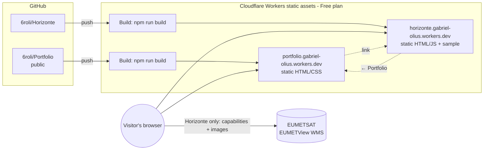

# Architecture

Each project is an independent GitHub repository with its own dependencies, checks and Cloudflare
project. The portfolio only links to the apps; nothing is shared at build time.



Plain-text version:

```
git push ──► GitHub ──► Cloudflare build (npm run build) ──► static files on the CDN (HTTPS)

Visitor ──► portfolio.gabriel-olius.workers.dev     Portfolio: HTML + CSS only
        └─► horizonte.gabriel-olius.workers.dev         Horizonte: HTML + JS
               └─► view.eumetsat.int    images requested directly by the browser
```

## Decisions

| Decision | Why |
|---|---|
| **Astro + CSS** for the portfolio | Content-driven site. Astro generates plain HTML with no client JavaScript, validates project files against a schema, and has built-in i18n routing for adding Spanish. |
| **Vite + TypeScript + Leaflet** for Horizonte | A single interactive page. Leaflet (the only runtime library) gives zoom, pan, scale and coordinates in a latitude/longitude projection without a tile server. |
| **Horizonte loads images directly from EUMETView** | EUMETView is EUMETSAT's public map service, built for web clients (CORS enabled, cacheable responses). This avoids a backend, a scheduled job and deployment secrets. The browser limits itself to 3 parallel requests. |
| **Cloudflare Git integration (Workers static assets)** | Builds and deploys on every push, preview versions for branches, status shown in GitHub, HTTPS and custom domains, all on the Free plan. Static requests are free and unlimited. No GitHub Actions and no API tokens. `wrangler.jsonc` declares each site as static files only. |
| **Checks run in the Cloudflare build** (`npm run build`) | A failing check stops the deployment. One place to look, no second CI system. |
| **One Cloudflare project per repository** | Each app deploys independently and can get its own subdomain. |
| **Local VS Code, no Docker or Codespaces** | Node.js and npm are all that is needed. Fewer moving parts to understand. |
| **No database, server, Kubernetes or GPU** | No concrete need. |
| **Copied CSS tokens, no shared library** | The projects share ~20 lines of CSS variables. A shared package would tie repositories together for no real gain. Revisit when several apps reuse real components. |
| **Python only when an analysis needs it** | Horizonte v1 only displays images. Future numerical analyses go in an `analysis/` folder with `pyproject.toml` and a local `.venv`. |
