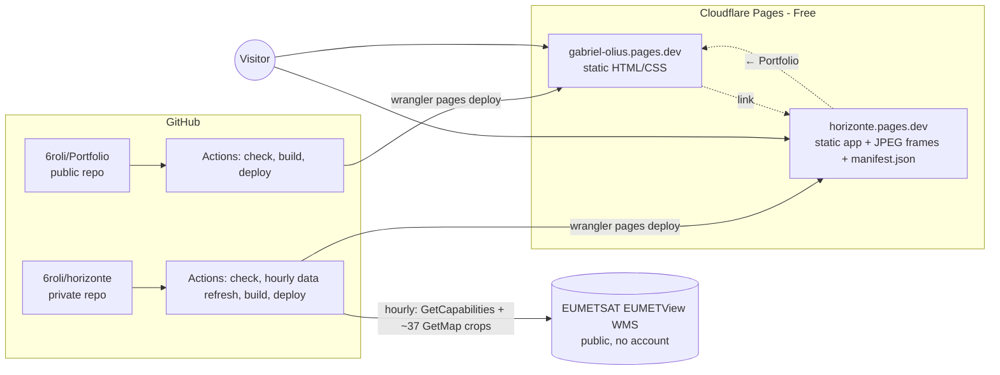

# Architecture

Each project is an independent repository with its own build, checks and deployment.
The portfolio only links to the apps; nothing is shared at build time.



Plain-text version:

```
Visitor ──► Cloudflare CDN ──► gabriel-olius.pages.dev   (Astro static pages)
        └─► Cloudflare CDN ──► horizonte.pages.dev       (Vite static app + prepared images)
                                       ▲
GitHub Actions (hourly) ──► EUMETView WMS ──► crops + manifest ──► build ──► deploy
```

## Decisions

| Decision | Why |
|---|---|
| **Astro** for the portfolio | Content-driven site; generates plain HTML with zero client JavaScript; typed content collections validate project pages at build time; built-in i18n routing for Spanish later. |
| **Vite + TypeScript + Leaflet** for Horizonte | A single interactive page. Astro would add a content layer it does not need. Leaflet (one dependency) gives zoom, pan, scale bar and coordinates in a lat/lon projection without any tile server. |
| **Static hosting, no backend** | Nothing needs to run per request. Data is prepared ahead of time by CI. No server to patch, no per-request cost. |
| **Cloudflare Pages** | Free plan includes unlimited static requests and bandwidth, preview deployments, custom domains with automatic HTTPS, and works with private repositories. GitHub Pages would require a paid plan for the private Horizonte repository. |
| **Deploy from GitHub Actions** (Direct Upload) rather than Cloudflare's Git integration | Horizonte needs a scheduled data refresh, which Git-integrated builds cannot do (and the 500 builds/month limit would not allow hourly builds). Using the same mechanism in both repos keeps them consistent and keeps all checks visible in GitHub. |
| **No Docker, database, permanent server, Kubernetes or GPU** | No concrete need. The dev container image is only for Codespaces/VS Code convenience. |
| **Copied design tokens, no shared library** | Two projects share ~20 lines of CSS variables. A shared package would create a dependency between repositories for no real gain. Revisit when 3+ apps reuse real components. |
